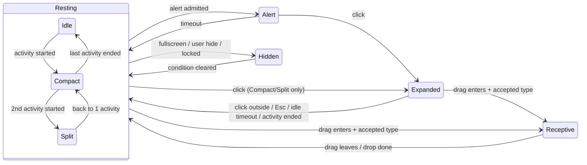

# Dynamic Island for Windows — Provider Platform Spec

2026-10-11 · Draft v0.1

Companion to *Dynamic Island for Windows — Technical Requirements*. That document covers the window, the rendering and the animation engine. This one covers **what the island shows and how anything, built-in or third-party, gets content onto it.**

> **Scope change:** the Technical Requirements list "Third-party plugin/extension system for other developers" as out of scope for v1. This spec reverses that: the island is a **platform**, and media, clipboard and battery become the first clients of a public provider API rather than hard-wired features.

---

## 1. The big picture

```
┌──────────────────────────── Cup Island host process ─────────────────────────────┐
│                                                                                   │
│  Providers ──► Activity Store ──► Arbiter ──► Presentation State ──► Renderer     │
│  (media,        (every live       (priority,   (Idle / Compact /     (Composition │
│   calendar,      activity +        queueing,    Split / Alert /       visuals,    │
│   file drop,     its content)      rate limits) Expanded /            morph       │
│   …plugins)                                     Receptive / Hidden)   animations) │
│      ▲                                                                    │      │
│      └───────────────────── actions, drops, expand/collapse ◄─────────────┘      │
└───────────────────────────────────────────────────────────────────────────────────┘
```

There are three rules. Everything else in this spec follows from them.

1. **Providers describe, the host draws.** A provider never gets a surface to paint on. It sends *structured content* (text, icon, progress, timer, buttons) into named *slots*, and the host lays it out, themes it, animates it and exposes it to screen readers. This is what makes the island look like one coherent thing whoever wrote the provider, and it is what keeps the idle cost at zero.
2. **Providers publish activities, the host decides what is visible.** A provider says "this exists, this is how important it is". The arbiter decides what the island shows at any moment. No provider can force itself on screen or steal the expanded view.
3. **Built-ins use the public API.** Media, clipboard and battery are written against the same contract third parties get. If the API can't express something a built-in needs, the API is incomplete.

This is the same split as Apple's ActivityKit. An app defines a Live Activity's data and its views per presentation (compact, minimal, expanded), and the system owns when and how each one appears.

---

## 2. Core concepts

| Concept | What it is | Apple equivalent |
| --- | --- | --- |
| **Provider** | A module that produces activities from some data source: media, calendar, file drop, a plugin | The app |
| **Activity** | One live thing the island can show, with an id, a lifecycle, a priority and content. Lives until ended | Live Activity |
| **Alert** | A brief, attention-getting moment attached to an activity, or standalone: track changed, meeting starts, file copied | Live Activity update with `AlertConfiguration` |
| **Content** | Structured data per presentation slot (see §5) | `ActivityConfiguration` views |
| **Action** | A button or tap the user performs, routed back to the owning provider by id | `Button(intent:)` / App Intents |
| **Drop target** | A provider's declaration that it can accept dragged items of certain types | *(none, our addition)* |
| **Presentation state** | What the island is doing right now: idle, compact, expanded, etc. | Dynamic Island presentations |

---

## 3. Presentation states

### 3.1 Resting vs. overlay states

The island has a **resting state** that depends only on the set of live activities, plus **overlay states** that temporarily take over in response to an event.

**Resting states**, derived from the activity store:

| State | When | Looks like |
| --- | --- | --- |
| **Idle** | 0 ongoing activities | Minimal pill/notch, no content. Zero CPU/GPU (TR §5, §8) |
| **Compact** | 1 ongoing activity | Pill widens; `compact.leading` + `compact.trailing` slots on either side (e.g. album art │ waveform) |
| **Split** | ≥ 2 ongoing activities | Top-ranked activity in compact form, plus a detached circular bubble showing the second one's `minimal` slot. Activities ranked 3 and lower are reachable from Expanded |

**Overlay states**, entered on events and always returning to the current resting state:

| State | Entered by | Leaves when | Looks like |
| --- | --- | --- | --- |
| **Alert** | A provider posts an alert that the arbiter lets through | Alert duration elapses (default 3 s), or the user clicks (→ Expanded) | Grows to medium size showing the `alert` slot, with an attention animation |
| **Expanded** | User clicks the island in Compact/Split/Alert | Click outside, Esc, 8 s with no pointer inside, or the shown activity ends | Large card with the `expanded.*` slots and action buttons. With several activities: a pager/switcher |
| **Receptive** | A drag enters the island's hot zone and ≥ 1 provider accepts the dragged data types | Drag leaves, or the drop completes | Opens into a row of drop zones, one per accepting provider (e.g. "Shelf", "Send to phone") |
| **Hidden** | Fullscreen detected (TR §9.2), user toggled hide, or session locked | Condition clears | Not visible. Alerts are held or dropped per §6.4 |

### 3.2 State diagram



The resting sub-state changes underneath overlays as well. If the media activity ends while an alert is showing, the island returns from the alert to Idle, not to Compact.

### 3.3 Precedence

When several events compete, the order is:

**Hidden > Receptive > Expanded > Alert > Resting**

- A drag always wins, because the user is actively doing something.
- **Expanded is never interrupted by an alert.** The alert is queued, and the activity's compact row in the switcher gets a badge or pulse instead. The one exception is `critical` level (§6.1).
- An alert arriving while another alert is showing is queued (§6.3), unless its level is higher, in which case it pre-empts.

### 3.4 Transition animations

All of these are Composition animations on the host side (TR §5). Providers can't define custom animations; they only choose content.

| Transition | Animation | Budget |
| --- | --- | --- |
| Idle ↔ Compact | Pill widens with a spring; content fades and scales in from the centre | 300 ms |
| Compact ↔ Split | Bubble buds off the pill's edge and separates (metaball-style), pill narrows | 350 ms |
| Resting → Alert | Morph to alert size with slight overshoot, followed by a single "breath" pulse | 300 ms + 200 ms |
| Alert → Resting | Ease-out shrink; alert content crossfades into compact content | 250 ms |
| → Expanded | Morph with a spring. Elements with the same `id` in both slots (e.g. album art) move between positions instead of crossfading (matched geometry) | 350 ms |
| Expanded → Resting | Reverse of the above | 300 ms |
| → Receptive | Fast spring open; drop zones stagger in by 30 ms each | 250 ms |
| Drop accepted | Zone flashes accent, then island collapses (into Compact if the drop created an activity) | 300 ms |
| Drop rejected / action failed | Horizontal shake, 3 cycles | 250 ms |
| Content update in place | Text crossfade; numbers roll; progress animates to the new value | 200 ms |
| Press (existing prototype) | Scale 0.96 on mouse-down, spring back on release | — |

Under Battery Saver (TR §8), springs become plain ease-outs, the pulse is skipped and matched geometry becomes a crossfade.

---

## 4. Activity lifecycle

```
start ──► update* ──► end ──► (dismissal) ──► removed
              │
              └── alert (optional, on start or on any update)
```

| Field | Description |
| --- | --- |
| `id` | Provider-unique. Restarting with an existing id means *update* |
| `kind` | `ongoing` (lives until ended: media, timer, upload, meeting soon) or `transient` (alert only, no resting presence: clipboard copied, charger plugged in) |
| `level` | Interruption level, §6.1 |
| `relevance` | 0.0–1.0, the tiebreaker among ongoing activities at the same level |
| `content` | Slot content, §5 |
| `staleAfter` | Optional. After this time the host dims the content and shows it as outdated (e.g. the provider died) |
| `dismissal` | On end: `immediate`, `afterSeconds(n)` (keep the final state visible, e.g. "Upload complete ✓"), or `at(time)` |

Each `update` sends the full content for the slots it changes, not a diff. Bounding the update rate is the host's job (§6.3).

**Time-based content is host-driven.** A countdown ("Standup in 4:59") is sent once as `timer{ target: 09:30 }`, and the host renders the ticking itself. Providers must never push once-a-second updates to animate a clock. This keeps us within the "no polling" rule (TR §8).

---

## 5. Content model

### 5.1 Slots

| Slot | Used in | Space | Typical content |
| --- | --- | --- | --- |
| `compact.leading` | Compact | ~1 icon | App icon, album art |
| `compact.trailing` | Compact | ~1 icon / short text | Waveform, countdown, % |
| `minimal` | Split bubble | 1 glyph | Icon or tiny progress ring |
| `alert` | Alert | 1–2 lines + icon | "Now playing — Song · Artist" |
| `expanded.leading` / `.trailing` | Expanded | Column | Art, big glyph / secondary info |
| `expanded.center` | Expanded | Title area | Title + subtitle |
| `expanded.bottom` | Expanded | Full width | Progress bar, buttons, list |

Every slot is optional. If a slot is missing, the host falls back to `minimal`, and then to the provider's icon.

### 5.2 Elements

The vocabulary is small and declarative. Layout uses `hstack`/`vstack` only.

| Element | Properties |
| --- | --- |
| `text` | `value`, `style` (title / body / caption / mono-digits), `maxLines` |
| `icon` | `symbol` (from the host's built-in icon set) **or** `image` (PNG/JPEG bytes or file URI, size-capped) |
| `progress` | `value` 0–1 or `indeterminate`, `shape` (bar / ring) |
| `timer` | `target` time, `direction` (down / up), `format` |
| `indicator` | Built-in live glyph: `waveform`, `recording-dot`, `spinner` |
| `button` | `label` and/or `icon`, `actionId`, `style` (primary / secondary / destructive) |
| `hstack` / `vstack` / `spacer` | Children, alignment |

- Every element can carry an `id`, which matched-geometry transitions use (§3.4).
- Activities can set an `accent` colour. The host adjusts it for contrast against light and dark themes.
- Every element has an accessible name, either derived from its text or given explicitly, and the host exposes it through UI Automation (TR §10).

### 5.3 Why not let providers render?

Arbitrary rendering would mean per-provider GPU surfaces, which rules out zero idle cost. It would also break morphing between layouts (the host can't match up elements it can't see), give an inconsistent look across providers, and lose accessibility. And for out-of-process plugins it means sharing GPU surfaces across processes, which is complex and a security risk. If a future need truly requires custom drawing, it gets its own reviewed extension point. It is not the default.

---

## 6. Arbitration

### 6.1 Interruption levels

| Level | Alert behaviour | Example |
| --- | --- | --- |
| `passive` | Never alerts; updates content silently | Battery % change |
| `active` *(default)* | Alerts unless the island is Expanded, Hidden, or in Focus/DND | Track change |
| `timeSensitive` | Like `active`, but also breaks through Focus/DND; pre-empts `active` alerts | Meeting starts in 1 min |
| `critical` | Can interrupt Expanded. **Built-ins only** in v1 | Battery 5% |

### 6.2 Ranking ongoing activities

Ongoing activities are ranked by: **user pin > level > relevance > most recently started**. Rank 1 gets the compact pill, rank 2 gets the Split bubble, and the rest show only in the Expanded switcher. Users can pin a provider ("always show media first") in settings.

### 6.3 Alert queue and budgets

- The queue holds at most 5 alerts. When full, the oldest `active` alert is dropped.
- **Coalescing:** an alert can carry a `coalesceKey`. A new alert with the same key replaces a queued one rather than adding to the queue. For example, skipping 4 tracks quickly produces 1 alert showing the last track, not 4.
- **Rate limit:** each provider can trigger at most 6 alerts per minute (configurable). Alerts over the limit are applied as silent content updates.
- **Update throttle:** content updates are capped at 10/s per activity. Excess updates are coalesced, and the latest one wins.

### 6.4 While Hidden

`active` alerts are dropped (the content still updates). `timeSensitive` and `critical` alerts are held for up to 30 s and shown when the island becomes visible. Whether `critical` should ever show over fullscreen is an open question, Q4.

---

## 7. Provider API

### 7.1 Manifest

```jsonc
{
  "id": "com.example.calendar",        // reverse-DNS, unique
  "name": "Calendar",
  "version": "1.2.0",
  "apiVersion": 1,                       // host refuses incompatible majors
  "icon": "calendar.png",
  "capabilities": ["activities", "alerts", "actions", "drop"],
  "drop": { "accepts": ["files", "text", "uri"], "label": "Add to event" },
  "maxLevel": "timeSensitive",           // ceiling; user can lower it
  "settings": [                          // rendered by the host's settings UI
    { "key": "leadMinutes", "type": "int", "default": 5, "label": "Show before meeting (min)" }
  ]
}
```

### 7.2 Contract

This is written as a language-neutral interface. §8 covers how it maps to C++ and to IPC.

**Provider → Host**

| Call | Purpose |
| --- | --- |
| `startActivity(id, kind, level, relevance, content, options)` | Create or replace an activity |
| `updateActivity(id, content, alert?)` | Change content, optionally with an alert |
| `endActivity(id, finalContent?, dismissal)` | End the activity |
| `postAlert(content, level, coalesceKey?)` | Transient alert with no ongoing activity |
| `setDropAvailability(enabled)` | E.g. the shelf is full |

**Host → Provider**

| Callback | Purpose |
| --- | --- |
| `onActivate(context)` / `onDeactivate()` | Lifecycle. `context` carries settings, theme and locale |
| `onAction(activityId, actionId)` | The user pressed a button, or the activity's primary tap action |
| `onExpandedChanged(activityId, isExpanded)` | Lets the provider fetch richer data only when it will be seen |
| `onDragEnter(dataTypes) → accept: bool` | Final say on accepting a specific drag |
| `onDrop(items) → result` | `accepted` / `rejected(reason)`. May start an activity (e.g. "3 files on Shelf") |
| `onSettingsChanged(settings)` | User changed a setting |

### 7.3 Sample message flow: calendar

```
08:55  startActivity("evt-123", ongoing, timeSensitive, 0.8,
          compact:  [icon calendar] [timer → 09:00]
          expanded: center "Standup" / "Room 4 · Teams"
                    bottom [button "Join" actionId=join] [button "Snooze" actionId=snooze])
       → island: Idle → Compact (countdown ticks host-side)
09:00  updateActivity("evt-123", content…, alert{ "Standup is starting" })
       → island: Compact → Alert → Compact
       user clicks → Expanded → clicks "Join"
       → onAction("evt-123", "join") → provider opens Teams link
09:01  endActivity("evt-123", dismissal: immediate)  → island: Compact → Idle
```

---

## 8. Hosting providers

These are built in two tiers that share one contract.

| | **Tier 1: in-process** | **Tier 2: out-of-process plugins** |
| --- | --- | --- |
| Who | Built-ins (media, clipboard, battery, file shelf) | Third parties, user scripts |
| How | C++ interface `IProvider` + `IHost`, loaded at startup | Separate process talking to the host over a **named pipe with JSON-RPC 2.0** using the same message shapes as §7 |
| Language | C++ | Anything: C#, Python, Node, Rust… |
| Crash impact | Built-ins are trusted and kept small | Plugin crash → its activities go stale, then end. Host restarts it with backoff |
| Discovery | Compiled in | `%LOCALAPPDATA%\CupIsland\providers\<id>\manifest.json` + executable |

Making Tier 2 JSON-RPC means one protocol serves every language, and the host never loads foreign code into its own process. That matters, because the host is a topmost always-running window that must not crash (TR §10). Thin SDKs (C#, Python, JS) can come later as convenience wrappers.

**Zero-code entry point (CLI):** `cupisland notify --title "Build done" --icon check --level active` posts a one-shot alert through the same pipe. It's useful for scripts, CI hooks and quick experiments, and it shows the platform working before any SDK exists.

---

## 9. Security, privacy and user control

- **Every third-party provider is off by default.** The user enables it in settings, and the settings screen shows its manifest capabilities ("can accept dropped files", "can alert during Focus").
- The host enforces each manifest's `maxLevel`, and the user can lower it per provider.
- Providers can't draw, read the screen, read other providers' activities or take keyboard focus. Text is length-capped and images are size-capped.
- Drop data goes to the provider the user dropped on, and no other.
- Tier 2 pipe: ACL'd to the current user. Each plugin gets a per-launch token so other processes can't impersonate it.
- Per-provider "mute" for 1 h / until tomorrow is reachable directly from the Expanded view (right-click or a `⋯` menu).
- Clipboard privacy from TR §7 still applies: alerts confirm *that* something was copied, not the content.

---

## 10. Reference providers

These are the built-ins that ship first. Each one exercises a different part of the API.

| Provider | Kind | Resting | Alert | Expanded | Exercises |
| --- | --- | --- | --- | --- | --- |
| **Media** (SMTC) | ongoing | art │ waveform | Track change (coalesced) | Art, title, artist, scrubber, ⏮ ⏯ ⏭ | Actions, matched geometry, coalescing |
| **Calendar** | ongoing (N min before) | icon │ countdown | "Starting now" | Title, location, Join/Snooze | Host-driven timers, `timeSensitive` |
| **File Shelf** | ongoing while it holds items | tray icon │ count | — | File list, drag-out, Clear | Receptive state, drops, drag out |
| **Clipboard** | transient | — | "Copied" + type icon | — | Transient alerts, privacy |
| **Battery** | transient (+ ongoing while charging, optional) | bolt │ % | Plugged / low | Level, time remaining | `passive` vs `critical` |
| **CLI notify** | transient | — | Arbitrary | — | Tier 2 pipe end-to-end |

---

## 11. Suggested milestone changes

This slots in alongside the TR §11 milestones:

| Phase | Change |
| --- | --- |
| 2 — Animation core | Add the full state set (Idle / Compact / Split / Alert / Expanded / Receptive / Hidden) driven by a fake activity store, so every transition in §3.4 exists before any real data does |
| 3 — Media | Built as the first Tier 1 provider **against `IProvider`**, not hard-wired |
| 4 — Secondary sources | Clipboard, battery, calendar, file shelf, all as Tier 1 providers |
| 4b — **Platform** *(new)* | JSON-RPC pipe, manifest discovery, settings UI, CLI `notify`, one sample Tier 2 plugin in a non-C++ language |

---

## 12. Open questions

1. **Calendar source:** Windows `AppointmentStore` (local and Outlook-synced only), or Google/Microsoft Graph with OAuth? The second contradicts "no network beyond update checks" (TR §10) unless it's done inside an opt-in plugin.
2. **Notifications from other apps:** TR §7 rules out intercepting toasts. `UserNotificationListener` is a public API that needs user consent. Do we want a "mirror Windows notifications" provider using it?
3. **Multiple monitors:** one island per monitor showing the same activities, or only on the primary display?
4. **Critical over fullscreen:** should `critical` ever show over a fullscreen game, or always wait?
5. **Hover:** the prototype deliberately has no hover reaction. Should hovering in Compact show a slight "peek" (tooltip-sized preview), or stay click-only?
6. **Plugin distribution:** folder drop-in only for v1, or a signed/registry model later?
